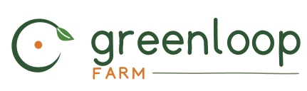

  

<b>Une petite ferme où chaque déchet devient une ressource, surveillée par des capteurs bon marché et pilotée depuis un téléphone.</b>

<a href="README.md">English</a> · Français · <a href="README.ar.md">العربية</a>

---

GreenLoop Farm est une micro-ferme intelligente et intégrée. Elle associe une vraie
ferme circulaire (légumes, arbres fruitiers, volailles, étang à poissons, abeilles et
escargots) à une couche d'automatisation IoT abordable et à une plateforme numérique
qui permet à d'autres petits agriculteurs de reproduire le modèle.

## Pourquoi

Les petites fermes perdent le plus sur ce qui est le plus facile à mesurer :
l'irrigation se fait par habitude et non selon les besoins du sol, les agriculteurs
n'ont aucune vue en direct du sol, de la météo, des animaux ou du matériel,
l'agriculture de précision coûte des dizaines de milliers d'euros, et les déchets
(fumier, tailles, eau de l'étang) sont jetés au lieu d'être réutilisés.

## La boucle

| De | Devient | Pour |
|---|---|---|
| L'eau de l'étang, riche en nutriments | Irrigation au goutte-à-goutte | Légumes et arbres fruitiers |
| Le fumier de volaille | Compost | Planches de légumes et verger |
| Les restes de légumes et de fruits | Aliment | Escargots et volailles |
| L'azolla cultivée sur l'étang | Aliment riche en protéines et engrais vert | Volailles, poissons et sol |
| Le maïs cultivé sur place | Aliment | 50 poules et 80 cailles |
| 10 ruches | Pollinisation et miel | Toutes les cultures et le verger |

## Ce qui existe aujourd'hui

- **Sur la ferme :** une porte de poulailler automatique Okköbi et une caméra solaire
  sont installées ; trois cartes ESP32 sont en cours de programmation.
- **Dans ce dépôt :** le backend (MQTT, base de données, Grafana, API, alertes Telegram,
  arrosage selon la météo), le tableau de bord web installable sur téléphone (PWA, en
  anglais, français et arabe), le site public, un calendrier des cultures pour 5 pays,
  une base de connaissances, un assistant agricole IA qui répond dans la langue de la
  question, et un agent qui propose des arrosages que l'agriculteur approuve.

## La plateforme

- **Calendrier des cultures** par pays et par mois (Lettonie, Algérie, France, Suède, Maroc).
- **Assistant agricole IA** : réponses simples sur les maladies, le sol, l'irrigation et
  les associations de cultures, tirées d'une base de connaissances d'agriculteurs expérimentés.
- **Boutique de la ferme** et **réservation de visites** (visites guidées, journées de
  cueillette, repas, écoles et équipes).

## Feuille de route

| Année | Objectif |
|---|---|
| **2026** | Créer l'entreprise en Lettonie, lancer la plateforme (calendrier, assistant, tableau de bord), ouvrir la boutique et les visites |
| **2027** | 500+ utilisateurs de l'assistant, offre payante pour les professionnels, premier acheteur d'escargots à l'export |
| **2028** | 100 k€+ de chiffre d'affaires annuel, licence du modèle à des fermes partenaires en Afrique du Nord et en Europe du Sud, versions arabe, française et anglaise |

Le plan détaillé est dans [ROADMAP.md](ROADMAP.md) (en anglais).

## Contact

**Boualem Hini**, fondateur · hinit.bth@gmail.com · [linkedin.com/in/hinibth7](https://linkedin.com/in/hinibth7)
