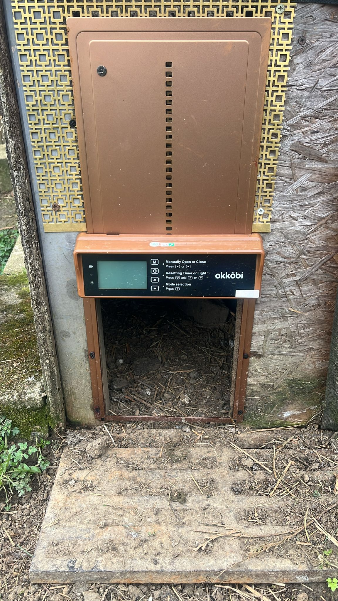
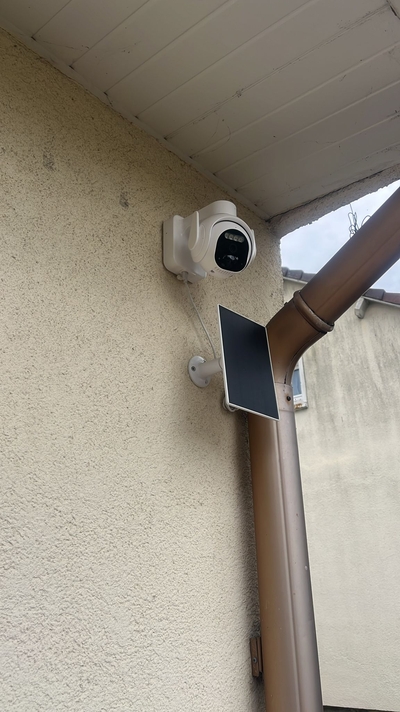
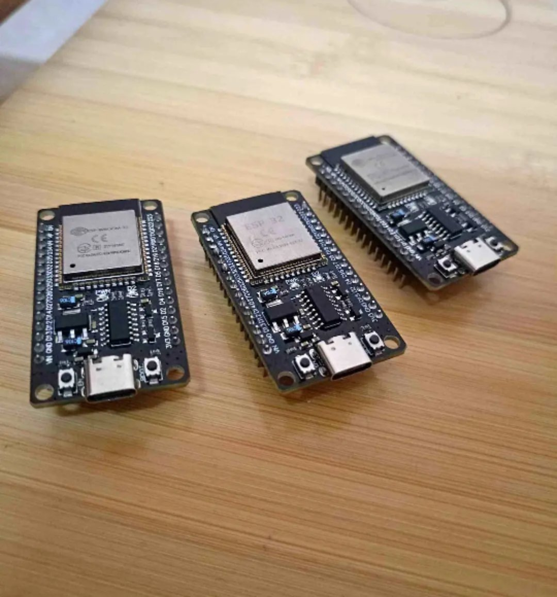
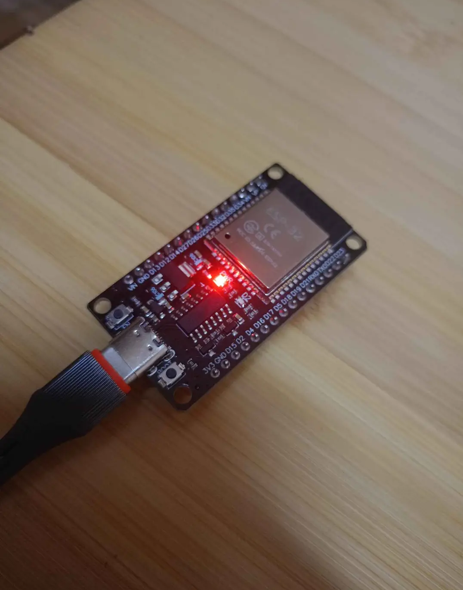
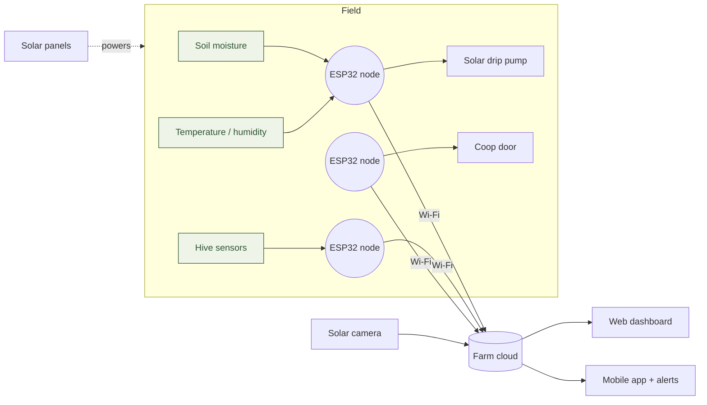

<p align="center">
  <picture>
    <source media="(prefers-color-scheme: dark)" srcset="assets/brand/greenloop-logo-dark.svg">
    
  </picture>
</p>

<p align="center">
  <b>A small working farm where every output becomes an input,<br>
  watched over by cheap sensors and run from a phone.</b>
</p>

<p align="center">English · <a href="README.fr.md">Français</a> · <a href="README.ar.md">العربية</a></p>

<p align="center">
  <a href="#the-loop">The loop</a> ·
  <a href="#on-the-farm-today">On the farm today</a> ·
  <a href="#how-it-fits-together">How it fits together</a> ·
  <a href="#the-digital-platform">Platform</a> ·
  <a href="#roadmap">Roadmap</a>
</p>

---

GreenLoop Farm is an integrated smart micro-farm. It combines a real, circular
farm (vegetables, fruit trees, poultry, a fish pond, bees and snails) with a
layer of affordable IoT automation and a digital platform that lets other
smallholders copy the model.

The farm is not only a production unit. It is a living model that shows how a
small plot can feed itself, save water, run on the sun and be managed remotely,
and every part of it is chosen so it can be rebuilt at low cost by a farmer
anywhere.

## Why

Small farms lose the most to the things that are easiest to measure.

- Irrigation runs on habit, not on what the soil actually needs, so water is wasted.
- Farmers have no live view of soil, weather, animals or equipment.
- Precision-agriculture tools are built for large farms and cost tens of thousands of euros.
- Waste streams (manure, trimmings, pond water) are thrown away instead of reused.

## The loop

The farm is laid out so that each part feeds the next. Nothing leaves the
system as waste.

| From | Becomes | For |
|---|---|---|
| Fish pond water, rich in nutrients | Drip irrigation | Vegetables and fruit trees |
| Poultry manure | Compost | Vegetable beds and orchard |
| Vegetable and fruit trimmings | Feed | Snails and poultry |
| Azolla grown on the pond | High-protein feed and green manure | Poultry, fish and soil |
| Corn grown on site | Feed | 50 hens and 80 quail |
| 10 beehives | Pollination and honey | Every crop and fruit tree |

**What grows here:** potatoes, lettuce, tomatoes, broad beans, corn and
mushrooms in the vegetable zone, and a perimeter belt of pomegranate, apricot,
lemon, orange, peach, mulberry and plum trees that doubles as a windbreak.

## On the farm today

The hardware below is bought and on site. The photos are from the farm.

<table>
  <tr>
    <td width="50%" valign="top">
      
      <h4>Automatic coop door</h4>
      An Okköbi door opens at sunrise and closes at sunset using its light
      sensor, so the flock is shut in before predators come out. It has a
      manual override and an LCD status panel.<br><br>
      <i>Next:</i> report open/closed state to the dashboard, alert when the
      door misses its schedule, and log daily activity.
    </td>
    <td width="50%" valign="top">
      
      <h4>Solar-powered camera</h4>
      A weatherproof, off-grid camera with its own solar panel, infrared night
      vision and a rotating head. It covers the poultry area, orchard entrance
      and irrigation zones.<br><br>
      <i>Next:</i> live feed in the dashboard and motion alerts on the
      farmer's phone.
    </td>
  </tr>
  <tr>
    <td width="50%" valign="top">
      
      <h4>ESP32 nodes ×3</h4>
      Three ESP32 boards are the IoT nodes of the system: reading sensors,
      driving the pump and door, and talking to the dashboard over Wi-Fi.
    </td>
    <td width="50%" valign="top">
      
      <h4>Being programmed now</h4>
      The firmware is being written and tested with a software engineering
      student and a software engineer, ahead of installation in the field.
    </td>
  </tr>
</table>

## How it fits together



1. Sensors in the beds, orchard and hives report to the ESP32 nodes.
2. The nodes push readings to the cloud and act locally, for example by
   starting the pond-fed drip pump when the soil dries out.
3. The dashboard and phone app show the whole farm at a glance and send
   alerts: a dry bed, a door that did not close, swarming risk in a hive.
4. Everything in the field runs on the on-site solar system, so the setup works
   off-grid.

## The digital platform

The physical farm proves the model. The platform is what lets it spread.

- **Crop calendar by country and month.** Pick a country (Latvia, Algeria,
  France, Sweden, Morocco…) and a month, and see what to plant, harvest or
  prepare in that climate.
- **AI farming assistant.** Plain-language answers on diseases, soil, irrigation
  schedules and companion planting, drawn from a curated base of knowledge from
  experienced farmers.
- **Farm shop.** Sell vegetables, eggs, fruit, honey and snails directly, with
  orders, delivery slots and payments.
- **Agri-tourism bookings.** Guided tours, harvest days, outdoor meals and school
  or startup-team visits.

**Business model:** direct farm sales, visit bookings, a free assistant with a
paid tier for professional farmers, commission on partner-farm sales, training
for farmers who want to replicate the model, and snail exports to European and
Scandinavian specialty markets.

**Who it's for:** smallholders in Europe, Scandinavia, North Africa and the
Middle East; European consumers who want traceable local food; agricultural
students and researchers; and visitors looking for a day on a working farm.

## Roadmap

| Year | Focus | Milestones |
|---|---|---|
| **2026** | Establish and build | Register the company in Latvia; ship the platform MVP (crop calendar, assistant, dashboard); Venture Catalysts program (LIAA / UniLab / RTU); open the shop and first visits |
| **2027** | Grow and validate | 500+ assistant users; paid tier for professional farmers; first snail export buyer; LIAA innovation voucher; school and team visits |
| **2028** | Scale | 100k+ EUR yearly revenue; license the model to partner farms in North Africa and Southern Europe; Arabic, French and English versions |

The detailed build plan, including why the web dashboard comes before a mobile
app and when the AI farm agent can be added, is in [ROADMAP.md](ROADMAP.md).

## Status

[](https://github.com/Samir-Guenchi/smart-micro-farm-iot/actions/workflows/firmware.yml)

Early stage and moving. The coop door and solar camera are installed and
working, the ESP32 boards are being programmed, and the dashboard integration is
underway. Early conversations with farm operators and customers are confirming
the demand.

## Repository layout

```
firmware/    ESP32 firmware, one PlatformIO project per node (in review)
hardware/    wiring diagrams, bill of materials, solar sizing (in review)
frontend/              everything that runs in the browser (hosted on Vercel)
  web/                 farm dashboard, an installable PWA
  site/                public landing page and crop calendar page
backend/               everything that runs on a server (hosted on Render)
  (services)           MQTT broker, TimescaleDB, Grafana, ingest, REST API, Telegram alerts, weather rule
  assistant/           AI farming assistant (answers from the knowledge base)
  agent/               farm agent: reads farm data, suggests actions, farmer approves
  knowledge/           farming notes for the assistant
  data/                crop calendar dataset
render.yaml            Render Blueprint for the backend
ml/          soil-drying prediction model
assets/      logo, mark and farm photos
docs/        architecture, monthly progress log, startup visa documents
ROADMAP.md   phased build plan for 2026–2028
```

How the parts connect, and the MQTT and API contracts, are in
[docs/architecture.md](docs/architecture.md). What has been done each month is
in [docs/progress-log.md](docs/progress-log.md). Hosting (Render for the backend,
Vercel for the frontend) is in [docs/deploy.md](docs/deploy.md).

## The logo

The "l" in greenloop is written as one cursive pen stroke, and the loop of
that "l" is a leaf. The stroke starts at an orange seed, rises as a hairline,
turns at the leaf tip, comes down heavy and crosses itself, so a single gesture
reads as the letter, a leaf and a closed loop: the farm's cycle, from seed back
to soil. The seed also sits where a dot would go, a quiet nod to the connected
side of the farm. The rest of the word is hand-lettered rather than typeset, and
the leaf-l on its own is the symbol.

Use `greenloop-logo-light.svg` on light backgrounds and `greenloop-logo-dark.svg`
on dark ones; `greenloop-mark-*.svg` is the symbol on its own, for avatars and
favicons. The PNG files are for documents and slides. To tweak and regenerate
the SVGs, run `python3 assets/brand/generate_logo.py assets/brand`.

## Founder

**Boualem Hini**, entrepreneur working at the meeting point of farming and
technology. Certified in fruit-tree cultivation, horticulture, poultry farming
and IoT network installation, with years of hands-on operations and food-service
experience.

- Email: hinit.bth@gmail.com
- LinkedIn: [linkedin.com/in/hinibth7](https://linkedin.com/in/hinibth7)

## License

Code is released under the [MIT License](LICENSE). Documentation, photos, the
knowledge base and the crop calendar data are CC BY 4.0. See
[CONTRIBUTING.md](CONTRIBUTING.md) to help build it.
