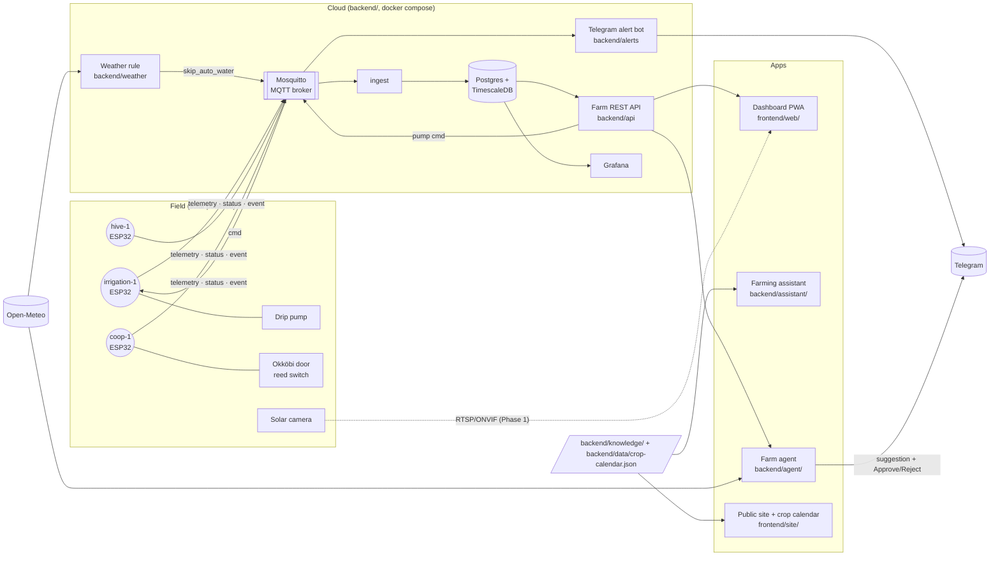

# Architecture

How GreenLoop Farm's sensors, cloud and apps fit together, and the contracts
between them. **The MQTT and REST API contracts below are the source of
truth:** firmware, backend, dashboard, assistant and agent all code against
them. Change them here first, in the same pull request as the code.

*Last updated: 30 October 2026.*

## The big picture

**Rules that keep it simple:**

1. **Nodes only talk MQTT.** They publish readings and events and obey `cmd`
   messages. They never call the API.
2. **Apps only talk to the REST API.** The dashboard, assistant and agent never
   touch the database or the broker directly.
3. **Safety limits live in firmware.** Maximum pump run (900 s) is enforced on
   the ESP32, so no software bug or agent can override it. The API and agent
   enforce the same cap again.
4. **Phones get alerts without an app.** Telegram first; PWA push next to it.

## Components

| Component | Folder | What it does | Status (30 Oct 2026) |
|---|---|---|---|
| Irrigation node | `firmware/irrigation-node` | Soil moisture, air temperature and humidity, flow pulse measurement; drives the pond-fed drip pump; waters automatically below threshold; obeys `pump` and `skip_auto_water` commands; hard 900 s pump cap | Phase 0 merged; flow logging included |
| Hive node | `firmware/hive-node` | Hive weight (load cell), hive temperature, battery | Phase 0 merged |
| Coop node | `firmware/coop-node` | Reed switch on the Okköbi door: reports `open`/`closed` on change | Phase 0 merged |
| Hardware docs | `hardware/` | Wiring diagrams, BOM with prices, solar sizing, flow sensor wiring and calibration | Phase 0 merged; flow reference included |
| MQTT broker | `backend/mosquitto` | Mosquitto with username/password, no anonymous access | Merged |
| Ingest | `backend/ingest` | Subscribes to `telemetry`, `status`, `event`; writes to TimescaleDB | Merged |
| Database | `backend/db` | Postgres 16 + TimescaleDB; readings hypertable, events, node status | Merged |
| Grafana | `backend/grafana` | "Farm overview" dashboard, the internal day-one view | Merged |
| Simulator | `backend/simulator.py` | Fake `irrigation-1`, `hive-1`, `coop-1` data; obeys pump commands | Merged |
| Farm API | `backend/api` | FastAPI: login, nodes, readings, events, pump control | Merged |
| Alert bot | `backend/alerts` | Telegram: bed too dry, door open after sunset, node offline, pump too long | Merged |
| Weather rule | `backend/weather` | Open-Meteo forecast; publishes `skip_auto_water` before rain | Merged |
| Dashboard | `frontend/web/` | React PWA: farm overview, bed with Water-now button, coop, settings; i18n with RTL | Merged |
| Public site | `frontend/site/` | Landing page, shop and visit links, crop calendar page; GitHub Pages | Merged |
| Crop calendar data | `backend/data/` | 5 countries × 12 months × 13 crops | Merged |
| Knowledge base | `backend/knowledge/` | Short farming notes for the assistant | Merged (drafts, founder review pending) |
| Farming assistant | `backend/assistant/` | Claude answers from `backend/knowledge/` and the calendar, with citations | Merged (prototype) |
| Farm agent | `backend/agent/` | Claude with read tools over the API; suggests watering; farmer approves on Telegram | Merged (v1, mock data) |
| Soil-drying model | `ml/` | Predicts hours until a bed needs water | Merged (trained on simulated data) |
| Camera | | Live stream and motion snapshots | Model/app unverified; issue #18 remains open |

## Node responsibilities

| Node id | Hardware | Publishes | Accepts on `cmd` |
|---|---|---|---|
| `irrigation-1` | ESP32, capacitive soil sensor, temperature/humidity sensor, GPIO18 flow pulse input, relay to the drip pump | `soil_moisture_pct`, `air_temp_c`, `air_humidity_pct`, `pump_on`, UTC-day `water_liters`, `battery_v`; stopped `pump` events include run `water_liters` | `{"action": "pump", "duration_s": N}` (capped at 900), `{"action": "skip_auto_water", "until": <ts>}` (retained) |
| `hive-1` | ESP32, load cell under the hive, temperature probe inside | `hive_weight_kg`, `hive_temp_c`, `battery_v` | nothing |
| `coop-1` | ESP32, reed switch on the door | `battery_v`; `door` events | nothing (the door runs on its own light sensor) |

More beds become `irrigation-2`, `irrigation-3`, and so on, with the same
payloads.

## Shared MQTT contract

Node ids: `irrigation-1`, `hive-1`, `coop-1`.

| Topic | Payload | Notes |
|---|---|---|
| `greenloop/<node_id>/telemetry` | `{"ts": 1767225600, "metrics": {"soil_moisture_pct": 41.2, "air_temp_c": 18.5}}` | every 60 s, QoS 0 |
| `greenloop/<node_id>/status` | `"online"` / `"offline"` | retained; `offline` is the MQTT last will |
| `greenloop/<node_id>/event` | `{"ts": ..., "type": "door", "state": "closed"}` or `{"ts": ..., "type": "pump", "state": "stopped", "reason": "manual", "water_liters": 1.2}` | on change or pump transition, QoS 1; stopped pump events include run volume |
| `greenloop/<node_id>/cmd` | `{"action": "pump", "duration_s": 600}` | QoS 1, node replies with an `event` |

Metric names: `soil_moisture_pct`, `air_temp_c`, `air_humidity_pct`, `pump_on` (0/1), `water_liters`, `hive_weight_kg`, `hive_temp_c`, `battery_v`.
Event types: `door` (`open`/`closed`), `pump` (`started`/`stopped`, with `reason`), `motion`.

Added since the roadmap, by the weather rule (#23): the retained
`greenloop/irrigation-1/cmd` message `{"action": "skip_auto_water", "until": <unix ts>}`
pauses automatic watering (not manual pump commands) until `until`.

`ts` is always unix seconds, UTC.

For irrigation, `water_liters` in telemetry is the cumulative volume for the
current UTC day, stored as pulse counts in ESP32 NVS. A pump `stopped` event
reports the measured volume for that run. Runs stopped before SNTP time is
available are retained in NVS as unassigned pulses and assigned to the UTC day
when time sync first becomes valid; a run that crosses midnight is assigned to
its stop day. Queued event timestamps are fixed at pump transition or first
valid time sync, even if MQTT reconnects later.

## Shared API contract

All under `/api`, JSON, `Authorization: Bearer <token>`.

| Method | Path | Returns |
|---|---|---|
| GET | `/api/nodes` | `[{"id": "irrigation-1", "status": "online", "last_seen": 1767225600, "latest": {"soil_moisture_pct": 41.2}}]` |
| GET | `/api/readings?node=&metric=&from=&to=` | `[{"ts": 1767225600, "value": 41.2}]` |
| GET | `/api/events?node=&type=&limit=` | `[{"ts": ..., "node": "coop-1", "type": "door", "state": "closed"}]` |
| POST | `/api/nodes/<id>/pump` body `{"duration_s": 600}` | `202 {"ok": true}` (publishes to the `cmd` topic) |

Implemented in `backend/api`, which also adds:

- `POST /api/login` `{"username", "password"}` → `{"token", "expires"}` (no auth needed).
- A fixed `API_SERVICE_TOKEN` for services that cannot log in (alert bot, agent).
- Defaults: readings cover the last 24 h when `from`/`to` are omitted; events
  are newest first, 50 by default, 500 at most.
- A node is `offline` if it said so or sent nothing for 10 minutes.
- `POST /pump` returns 404 for nodes without a pump and 503 if the broker is
  unreachable; `duration_s` is capped at 900.

Interactive docs: `/api/docs` on a running API.

## AI pieces and how they stay safe

| | Reads | Can do | Guard rails |
|---|---|---|---|
| Assistant (`backend/assistant/`) | `backend/knowledge/`, crop calendar | Answer questions | Answers only from the notes, cites them, says "I don't know" otherwise |
| Agent (`backend/agent/`) | API (nodes, readings, events), Open-Meteo | Suggest watering a bed | Every action needs the farmer's Approve on Telegram; irrigation nodes only, 15 min max; nothing for the coop door or animals; every suggestion, decision and outcome logged |
| Model (`ml/`) | Moisture history, weather, forecast | Predict hours until a bed needs water | Advisory only; feeds the agent's suggestions |

## Data model (TimescaleDB)

See `backend/db/init.sql` for the exact schema. In short:

- **readings** (hypertable): `ts`, `node`, `metric`, `value`, one row per metric per message.
- **events**: `ts`, `node`, `type`, `state`, `reason`.
- **node_status**: `node`, `status`, `last_seen`.

## Where things run

Everything in `backend/` runs on one small server (or a Raspberry Pi on the
farm) with `docker compose`. The dashboard and public site are static files:
the site is on GitHub Pages; the dashboard can be served from the same server
or any static host. The assistant and agent are small Python services next to
the backend, and need an Anthropic API key.
